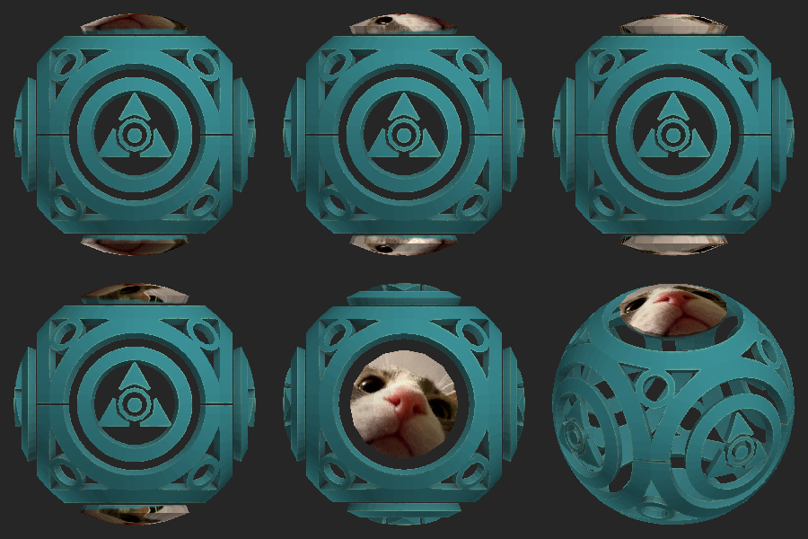

# Deadlock Picture Mod — gato en el Soul Container

Mod de cliente para Deadlock que reemplaza la textura del **soul container** (el orbe que queda cuando mueres con almas sin asegurar) para que los discos de arriba y abajo muestren una foto de mi gato.



## Cómo funciona

- El asset del juego es `models/props_gameplay/soul_container/soul_container.vmdl_c`. Su textura de color es `.../materials/soul_container_color_png_1da67bfe.vtex_c`: un atlas UV de 2048×2048 en BC7 con 10 mips.
- Ese `.vtex_c` es una cabecera de 2132 bytes seguida de los mips BC7 sin comprimir, guardados del más chico al más grande. El build **reutiliza la cabecera original** y reemplaza solo los datos de los píxeles. Así no hace falta el `resourcecompiler` de Valve (que solo funciona en Windows).
- El resultado se empaqueta como `pak09_dir.vpk` en `game/citadel/addons/`. Deadlock Mod Manager usa de `pak01` a `pak08`.

Regiones del atlas UV (encontradas renderizando texturas de depuración, ver `scripts/compose.py`):

| Región | Píxeles | Superficie en el modelo |
|---|---|---|
| Disco | círculo (400, 840) r≈232 | discos de arriba y abajo |
| Marco | (920,500)–(2048,1640) | marco ornamental de las 4 caras laterales |
| Triángulos | (0,1000)–(1060,2048) | emblemas triangulares |

## Uso (Linux)

```bash
python3 -m venv .venv && .venv/bin/pip install -r requirements.txt
.venv/bin/python scripts/fetch_original.py      # extrae la textura original desde tu instalación del juego
.venv/bin/python scripts/compose.py             # assets/cat.jpg -> assets/soul_container_color.png
.venv/bin/python scripts/build.py               # -> build/pak09_dir.vpk
./scripts/install.sh                            # copia el pak a addons/ (./scripts/uninstall.sh para quitarlo)
```

- `compose.py --variant full` pinta la foto también en los marcos laterales. Queda fragmentada, por eso no es la opción por defecto.
- Para usar otra foto, cambia `assets/cat.jpg` y ajusta `FACE_CROP` en `compose.py`.
- `scripts/preview_render.py <modelo.glb> <textura.png> <salida.png>` genera una vista previa del modelo desde 6 ángulos. El `.glb` se exporta con Source 2 Viewer CLI: `-i soul_container.vmdl_c -o sc.glb -d --gltf_export_format glb`.

## Notas

- Solo cambia una textura de tu cliente: los demás jugadores no ven el gato.
- Si una actualización del juego cambia la cabecera o el nombre del archivo, hay que volver a correr `fetch_original.py` y el build.
- Si Deadlock Mod Manager reescribe `addons/`, puede borrar `pak09`. En ese caso, vuelve a correr `install.sh` o importa `build/pak09_dir.vpk` desde el propio DMM.
